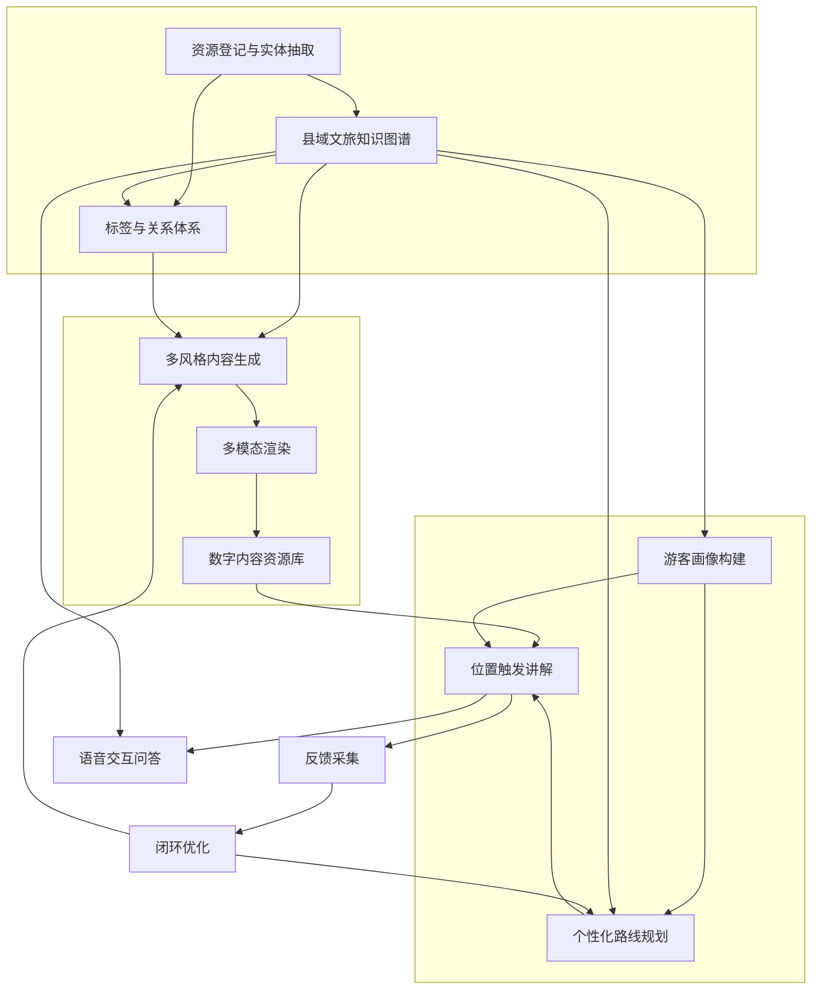
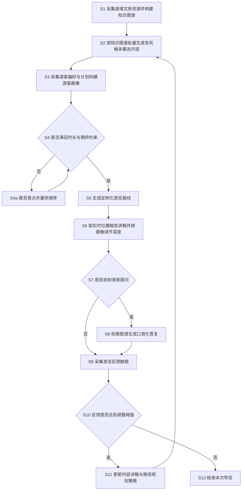

# 技术交底书

**案件名称**：一种面向县域文旅的 AI 多模态数字内容生成与智能导览方法及系统

**技术联系人**：
- 姓名：[待填写]
- 电话：[待填写]
- 邮箱：[待填写]

**专利类型**：发明

---

## 注意事项

（1）交底书应使代理人能看懂，尤其是背景技术和详细技术方案，一定要写得全面、清楚、完整；
（2）技术的公开程度，应以本领域普通技术人员不需付出创造性劳动即可进行实施为准。
（3）在与代理人沟通时，对于代理人咨询的技术问题，应给予回答并认真讲解，并且按要求及时正确地补充相应技术材料。

---

## 一、技术背景与现有技术

### 1.1 现有技术

**检索说明**：在国家知识产权局专利公布公告系统及 Google Patents 中，以"文旅知识图谱""多模态内容生成""智能导览""个性化路线规划""AIGC 文旅文案"等为检索词进行检索，并按技术方向分类整理。下列条目的技术方案与局限均以其公开文本为依据概括，每条附可公开访问的来源链接。

#### 方向一：基于大模型与定位的个性化导览

- **CN118608726A**，集成室内外高精度定位和大模型的智能导览方法及系统。该方案开发部署于用户终端的应用，构建场景数据、用户数据与讲解点数据的管理平台，由大模型根据场景信息、讲解点信息与用户信息生成个性化内容，并在场景中布设音频脉冲基站设备实现高精度室内定位。**局限性**：个性化讲解依赖音频脉冲基站等专用硬件布设，县域景区难以承担硬件采购与维护成本；方案面向单一封闭场景（展厅/景点内部），未涉及县域级多景点资源的统一知识组织，也不支持面向不同县域的快速复制。
  - 来源链接：https://patents.google.com/patent/CN118608726A/zh

- **CN116233383A**，一种基于 AR 技术的智能导游系统。该方案通过移动摄像装置扫描景区景观，提取图像特征向量并在云端重组得到虚拟景观图像，结合空间定位展示 3D 虚拟景观图像与解说语音包。**局限性**：以视觉重建与 AR 呈现为核心，内容生产仍依赖预先录制的景观解说语音包，不具备批量自动生成多风格讲解内容的能力；未构建可复用的文旅知识组织，换一个县域需重新采集与重建。
  - 来源链接：https://patents.google.com/patent/CN116233383A/zh

#### 方向二：景区路线规划与拥挤度调度

- **CN115048433A**，一种景区智能导览系统。该方案包括攻略服务、地图服务、数据分析与路线规划模块，数据分析模块计算景点的拥挤系数与增长系数，路线规划模块依据拥挤系数、增长系数与游客对景点的标注进行线路规划。**局限性**：路线规划依据的是历史统计意义上的拥挤系数与增长系数，缺乏面向游客个体的画像建模，不能按游客的知识背景、同行人员构成与游览时长生成差异化路线；且不涉及讲解内容的生成与适配，导览内容与服务调度是分离的。
  - 来源链接：https://patents.google.com/patent/CN115048433A/zh

#### 方向三：文旅知识组织与内容生成

- **CN112667764A**，一种基于知识图谱技术的文化要素构建方法。该方案收集空间数据、文化数据与旅游数据的基础信息，构建线性文化遗产沿线的文化要素知识图谱，形成二三维一体化展示的文化遗产旅游地图。**局限性**：知识图谱用于资源展示与地图可视化，未与内容生成链路打通，不能由图谱实体自动派生讲解文案、宣传图文、讲解语音与短视频脚本；也缺乏面向游客的内容消费与反馈回路。
  - 来源链接：https://patents.google.com/patent/CN112667764A/zh

- **CN118113150A**，基于元宇宙的在线文旅互动体验系统。该方案构建数字孪生场景模块、文旅叙事体验模块、虚拟人物交互模块与内容创作支持模块，基于 AIGC 生成虚拟场景、虚拟角色与故事情节元素以及文字、图像、音频形式的内容。**局限性**：以线上元宇宙空间为载体，重心在虚拟场景构建与数字资产交易，对线下实体景区的现场导览（位置触发讲解、现场路线执行）支撑不足；系统以数字孪生场景为前提，建设成本高，不适用于县域线下文旅的轻量化改造。
  - 来源链接：https://patents.google.com/patent/CN118113150A/zh

**检索总结**：现有技术在"个性化导览"方向上依赖专用硬件或 AR 重建，部署成本高；在"路线规划"方向上以历史拥挤系数为依据，缺乏个体画像建模；在"知识图谱"方向上止于资源可视化，未打通内容生成；在"AIGC 内容生成"方向上以线上虚拟场景为载体，与线下现场导览脱节。

**本发明与现有技术的本质区别**：本发明以**县域文旅知识图谱**为统一的知识底座，将"多模态数字内容批量生成"与"现场位置触发的自适应智能导览"纳入同一条闭环链路——图谱既驱动内容生产，又驱动讲解触发与问答检索；游客画像同时约束路线规划与讲解深度；游客反馈反向更新内容质量与路径策略，形成"内容生产—智能导览—互动反馈"的全链路闭环。该方案不依赖专用定位硬件与虚拟场景建设，以图谱结构与标签体系实现跨县域快速复制。

### 1.2 现有技术存在的缺点

1. **部署成本高，县域难以承担**：个性化导览方案依赖音频脉冲基站、AR 重建或元宇宙数字孪生场景，硬件采购、场景采集与维护成本远超县域文旅运营主体的承受能力。
2. **知识组织与内容生产割裂**：知识图谱类方案只做资源展示，不驱动内容生成；内容生成类方案又缺少统一的知识底座，生成内容易出现事实错误、风格漂移，且无法跨县域复用。
3. **内容风格单一，无法适配不同游客群体**：讲解内容多为预先录制的单一版本，不能按游客的知识背景、年龄结构、同行人员构成动态调节讲解的深度与风格。
4. **路线规划缺乏个体化约束**：以历史拥挤系数为依据做调度，未将游客画像（偏好、计划游览时长、同行人员）作为约束条件，无法为不同游客生成差异化路线。
5. **缺少反馈闭环**：内容生成后即静态固化，游客的停留时长、评分、追问、跳过等行为数据未回流用于优化内容质量与路径策略，服务效果无法持续提升。
6. **可复制性差**：方案与具体场景强绑定，换一个县域需重新采集、重建与标注，难以规模化推广。

---

## 二、本发明所要解决的技术问题

针对上述缺点，本发明要解决的技术问题是：

1. 如何在不依赖专用定位硬件与虚拟场景建设的前提下，为县域文旅提供低成本、可实施的智能导览能力；
2. 如何用统一的知识组织把分散的景点、非遗、美食、历史人物与历史事件资源结构化，并使之同时驱动内容生产与现场讲解；
3. 如何按游客个体差异批量生成多风格、多模态的数字文旅内容，使同一实体可派生简约版、历史深度版、亲子趣味版等差异化内容；
4. 如何将游客画像作为约束，综合景点热度、实时人流与计划游览时长生成定制化的、避堵的游览路线；
5. 如何根据游客实时位置自动触发讲解，并按画像调节讲解的深度与风格，同时支持基于图谱的语音交互问答；
6. 如何把游客的反馈数据回流，反向优化内容质量与路径规划策略，形成持续提升的闭环；
7. 如何使上述能力以知识图谱为承载实现跨县域快速复制，降低单县域的数字化边际成本。

---

## 三、本发明技术方案的详细阐述

### 3.1 背景

**场景与参与者**。本案的场景是县域文旅的数字化运营：某县域文旅运营方（文旅局或运营公司）拥有景点、非物质文化遗产、民俗活动、特色美食、历史人物与历史事件等文旅资源，但缺少专业的内容制作团队与导览服务人员。参与方包括：县域文旅运营方，负责提供与审核文旅资源资料、维护实体与标签；内容生成服务，负责把资源资料批量转化为讲解文案、宣传图文、讲解语音与短视频脚本；导览服务，负责在游客游览现场按位置触发讲解并回答提问；游客，通过移动终端扫码进入，提交偏好与计划游览时长，按生成的路线游览并提交反馈。

**标题对象如何进入系统**。县域文旅资源以"实体登记"的方式进入系统：运营方按预设的实体类型（景点、人物、非遗、美食、历史事件）逐条登记资源资料，每条资源登记其名称、正文描述、地理位置、年代、开放时段与文化标签；登记完成后由关系登记环节按预设关系类型（位于、关联、传承、制作、发生于、擅长）建立实体之间的关联，形成县域文旅知识图谱。图谱一旦建立，即同时成为内容生成的上下文来源与现场讲解、问答的检索来源——内容生成服务按实体逐个派生多模态内容，导览服务按游客位置定位到实体后取用对应内容。

**高频术语的场景定义**：

- **县域文旅知识图谱**：把某县域的文旅资源登记为实体并登记实体之间关联关系后形成的结构化资源集合，是内容生成与导览检索的共同底座。
- **数字内容资源库**：由图谱实体派生出的多风格、多模态内容的集合，按"实体—风格—模态"三元组组织并做版本管理。
- **游览风格**：同一实体的讲解内容按不同游客群体预设的输出变体，至少包括简约版、历史深度版、亲子趣味版。
- **游客画像**：由游客主动提交的个人偏好、计划游览时长、同行人员构成，结合其历史行为（浏览、收藏、评分、停留）形成的游客特征描述，用于约束路线规划与讲解深度。
- **实时人流拥挤度**：景点当前时段在园人数的归一化度量，取值越大表示越拥挤，用于路线避堵。
- **内容完备度**：某实体已生成的内容模态数占目标模态数的比例，用于衡量该实体的内容是否已齐备到可上线导览。

### 3.2 系统框图

### 3.3 模块功能说明

- **资源登记与实体抽取**：接收运营方登记的景点、人物、非遗、美食、历史事件资料，对非结构化文本做实体识别、关系分类与属性标注，输出带属性与标签的实体记录。向下游提供结构化的实体与关系，是知识图谱的唯一数据来源。

- **县域文旅知识图谱**：存储实体、实体属性与实体间关联关系，并建立实体名称、标签与关系的索引。向上为内容生成提供上下文，向上为路线规划提供景点间关联与步行接驳信息，向上为讲解触发与问答提供检索来源；是整个方案的知识底座。

- **标签与关系体系**：维护预设的实体标签集合与关系类型集合（位于、关联、传承、制作、发生于、擅长），为实体标注文化标签、约束关系抽取的类别。与知识图谱双向依赖：图谱按该体系组织，体系随图谱扩展而补充。

- **多风格内容生成**：以图谱实体及其关联实体、属性、文化标签构造生成上下文，按预设的多种游览风格模板批量生成讲解文案。向上输出文本形态的内容，交给多模态渲染进一步派生其它模态。

- **多模态渲染**：把生成出的讲解文案派生为宣传配图、讲解语音与短视频脚本——配图由文案中的视觉关键元素构造提示词后生成，语音由文案经语音合成转换并支持普通话与本地方言两种音色，短视频脚本按分镜场景、画面描述、台词文案、时长建议四字段组织。

- **数字内容资源库**：按"实体—风格—模态"三元组组织生成结果并做版本管理，记录每条内容的版本、来源风格与生效状态。向下游的讲解触发与问答提供按实体与风格检索内容的能力；同时接收闭环优化模块的内容质量调整指令。

- **游客画像构建**：接收游客提交的个人偏好、计划游览时长、同行人员构成，并结合其浏览、收藏、评分、停留等历史行为，形成游客画像。向下约束路线规划的偏好项与时长约束，向下决定讲解触发时的深度档位与讲解风格。

- **个性化路线规划**：以游客画像为约束，综合景点常态化热度、实时人流拥挤度、内容完备度与景点间步行接驳时长，在满足计划游览时长约束的前提下求解景点入选与游览顺序，输出带建议游览时长与最佳拍照点标注的定制路线。与知识图谱交互取得接驳关系，与数字内容资源库交互取得完备度。

- **位置触发讲解**：获取游客实时位置，当游客进入某景点的触发半径时自动定位到对应实体，按游客画像选择讲解风格与深度档位，从数字内容资源库取出对应内容并推送播报。与游客画像、数字内容资源库直接关联，并触发后续的语音交互问答入口。

- **语音交互问答**：接收游客的语音提问，转换为文本后在知识图谱中检索相关实体与关联关系，结合游客画像的深度档位组织答案并转换为语音输出。与知识图谱、游客画像关联，问答记录回传反馈采集模块。

- **反馈采集**：记录游客在游览过程中与结束后的反馈数据，包括对讲解内容的评分、详略评价、跳过行为、停留时长、追问内容与路线执行偏离情况。向下游的闭环优化提供原始反馈。

- **闭环优化**：按反馈数据更新景点常态热度与内容质量评分，并据此调整内容生成的详略参数与路线规划的景点顺序策略。其输出回流至多风格内容生成（调整内容详略）与个性化路线规划（调整排序策略），形成闭环。

### 3.4 系统流程说明

#### 流程图

#### 流程说明

**S1、采集县域文旅资源并构建知识图谱**。采集县域范围内的景点、非物质文化遗产、民俗活动、特色美食、历史人物与历史事件资料，来源包括地方志文档、文旅主管部门公开资料、景点介绍文本、非遗申报材料与美食文化资料；对非结构化文本做实体识别，按预设关系类型集合做关系分类，并补充描述、年代、地理位置与文化标签等属性，形成县域文旅知识图谱，并建立实体名称、标签与关系的索引。

**S2、按知识图谱批量生成多风格多模态内容**。以图谱实体及其关联实体、属性与文化标签构造生成上下文，按预设的简约版、历史深度版、亲子趣味版等游览风格模板批量生成讲解文案；再由文案派生宣传配图、讲解语音（普通话与本地方言两种音色）与分镜式短视频脚本，按"实体—风格—模态"三元组存入数字内容资源库并做版本管理。

**S3、采集游客偏好与计划构建游客画像**。获取游客提交的个人偏好、计划游览时长与同行人员构成，并结合其浏览、收藏、评分与停留等历史行为，形成游客画像，输出偏好匹配度、计划游览时长与内容深度档位三项用于下游的量化描述。

**S4、判断候选路线是否满足时长与拥挤约束**。以式 (1) 计算各景点入选分并排序形成候选路线，再以式 (2) 校验候选路线的游览时长与步行接驳时长之和是否不超过游客计划游览时长，并检查路线中是否存在拥挤度超过阈值的景点。不满足时进入 S4a。

**S4a、裁剪景点并重排顺序**。按入选分从低到高裁掉尾部景点，并对被裁景点在路线中的相邻关系做接驳重排，随后回到 S4 重新校验，直至满足约束或景点数降至下限。

**S5、生成定制化游览路线**。输出满足约束的定制路线，标注每个景点的建议游览时长、最佳拍照点与推荐讲解风格，作为现场导览的执行依据。

**S6、按实时位置触发讲解并按画像调节深度**。获取游客实时位置，当游客进入某景点的触发半径时定位到对应实体，按式 (3) 确定的内容深度档位与游客画像选定的讲解风格，从数字内容资源库取出对应内容并推送播报。

**S7、判断是否收到语音提问**。讲解播报完成后开放语音交互入口，收到游客提问则进入 S8，否则进入 S9。

**S8、检索图谱生成口语化答复**。把语音提问转换为文本，在知识图谱中检索命中实体及其关联关系，结合游客画像的深度档位组织答案，转换为语音输出，并把问答记录回传反馈采集环节。

**S9、采集游览反馈数据**。记录游客对讲解内容的评分、详略评价、跳过行为、各景点实际停留时长、追问内容与路线执行偏离情况。

**S10、判断反馈是否达到调整阈值**。统计反馈得到的景点反馈得分与内容质量评分，当其相对当前值的偏差超过预设调整阈值时进入 S11，否则进入 S12。

**S11、更新内容详略与路径规划策略**。按式 (4) 更新景点常态热度，并据此调整内容生成的详略参数与路线规划的景点顺序策略，更新结果回流至 S2 的内容生成环节与 S4 的路线规划环节。

**S12、结束本次导览**。归档本次导览的路线、讲解记录与反馈数据，作为下一轮画像构建的历史行为依据。

#### 3.4.1 符号与公式

##### （1）景点侧符号

| 符号 | 含义 | 下标/量纲 |
|------|------|-----------|
| \(i\) | 县域内景点索引 | \(i=1,\ldots,N\) |
| \(h_{i}\) | 景点 \(i\) 的常态化热度 | \([0,1]\)，由历史访问量与评分归一化 |
| \(c_{i}\) | 景点 \(i\) 的实时人流拥挤度 | \([0,1]\)，越大越拥挤 |
| \(w_{i}\) | 景点 \(i\) 的建议游览时长 | 单位 min |
| \(g_{i}\) | 景点 \(i\) 的数字内容完备度 | \([0,1]\)，已生成模态数与目标模态数之比 |
| \(t_{i,j}\) | 景点 \(i\) 到景点 \(j\) 的步行接驳时长 | 单位 min |
| \(f_{i}^{(t)}\) | 第 \(t\) 轮景点 \(i\) 的游客反馈得分 | \([0,1]\) |

##### （2）游客侧符号

| 符号 | 含义 | 下标/量纲 |
|------|------|-----------|
| \(u\) | 游客标识 | — |
| \(p_{u,i}\) | 游客 \(u\) 对景点 \(i\) 的偏好匹配度 | \([0,1]\) |
| \(T_{u}\) | 游客 \(u\) 的计划游览时长 | 单位 min |
| \(d_{u}\) | 游客 \(u\) 的内容深度档位 | 取值 1、2、3 |
| \(k_{u}\) | 游客 \(u\) 的知识背景水平 | \([0,3]\) |
| \(r_{u}\) | 游客 \(u\) 的互动参与度 | \([0,3]\) |
| \(q_{u}\) | 游客 \(u\) 的同行人员构成因子 | \([0,3]\) |

##### （3）权重与阈值符号

| 符号 | 含义 | 下标/量纲 |
|------|------|-----------|
| \(\alpha,\beta,\gamma,\delta\) | 入选分中偏好、热度、拥挤、完备度的权重 | 非负，\(\alpha+\beta+\gamma+\delta=1\) |
| \(\theta_{1},\theta_{2},\theta_{3}\) | 深度档位中知识背景、互动参与度、同行构成的权重 | 非负，\(\theta_{1}+\theta_{2}+\theta_{3}\leq 1\) |
| \(\eta\) | 反馈更新步长 | \((0,1)\) |
| \(\tau\) | 拥挤度上限阈值 | \([0,1]\) |

##### 核心公式

景点入选分由游客偏好匹配度、景点常态化热度、实时人流拥挤度与数字内容完备度加权得到：

\[ s_{u,i} = \alpha p_{u,i} + \beta h_{i} - \gamma c_{i} + \delta g_{i} \tag{1} \]

其中拥挤度取负号，使实时拥挤的景点在排序中被降权，从而实现避堵。

候选路线须满足计划游览时长约束，即游览时长与步行接驳时长之和不超过计划时长，且路线中各景点拥挤度均不超过 \(\tau\)：

\[ \sum_{i \in R} w_{i} + \sum_{(i,j) \in R} t_{i,j} \leq T_{u} \tag{2} \]

讲解内容的深度档位由游客的知识背景水平、互动参与度与同行人员构成因子加权后向下取整得到：

\[ d_{u} = \left\lfloor \theta_{1} k_{u} + \theta_{2} r_{u} + \theta_{3} q_{u} + 1 \right\rfloor \tag{3} \]

且 \(d_{u} \leq 3\)，即加权结果超过 3 时按 3 截断。档位 1 对应简约版、2 对应标准版、3 对应历史深度版。

景点常态化热度按游客反馈得分做指数平滑更新，使反馈持续影响后续的路线上游与内容详略：

\[ h_{i}^{(t+1)} = (1 - \eta) h_{i}^{(t)} + \eta f_{i}^{(t)} \tag{4} \]

### 3.5 关键技术参数

| 符号 | 参数名 | 取值范围 | 说明 |
|------|--------|----------|------|
| \(\alpha\) | 偏好权重 | 0.30 ~ 0.50 | 路线排序中游客偏好匹配度的占比 |
| \(\beta\) | 热度权重 | 0.15 ~ 0.30 | 景点常态化热度的占比 |
| \(\gamma\) | 拥挤权重 | 0.10 ~ 0.25 | 实时人流拥挤度的降权强度 |
| \(\delta\) | 完备度权重 | 0.05 ~ 0.20 | 数字内容完备度的占比 |
| \(\tau\) | 拥挤度上限阈值 | 0.60 ~ 0.85 | 超过该值的景点不纳入路线 |
| \(w_{i}\) | 建议游览时长 | 15 ~ 90 min | 按景点规模与内容量设定 |
| \(T_{u}\) | 计划游览时长 | 60 ~ 480 min | 由游客主动提交 |
| \(\theta_{1}\) | 知识背景权重 | 0.20 ~ 0.40 | 深度档位中知识背景的占比 |
| \(\theta_{2}\) | 互动参与度权重 | 0.15 ~ 0.35 | 追问与停留行为的占比 |
| \(\theta_{3}\) | 同行构成权重 | 0.10 ~ 0.30 | 亲子/结伴/独行等的占比 |
| \(d_{u}\) | 内容深度档位 | 1 / 2 / 3 | 分别对应简约版、标准版、历史深度版 |
| \(\eta\) | 反馈更新步长 | 0.05 ~ 0.30 | 越大反馈影响越快，过大易振荡 |

### 四、与现有技术相比的优点

总体上看，本发明把县域文旅的"知识组织、内容生产、现场导览、反馈优化"整合为一条以知识图谱为底座的闭环链路，在不增加专用硬件投入的前提下，同时解决了内容制作成本高、导览服务同质化与方案难以复制三个问题。

1. **部署成本低**：位置触发讲解基于游客移动终端的通用定位能力与景点触发半径判定实现，无需布设音频脉冲基站、AR 采集设备或元宇宙数字孪生场景，县域运营方以常规软件部署即可上线。
2. **知识组织与内容生产打通**：知识图谱既作为内容生成的上下文来源，又作为现场讲解与问答的检索来源，避免了"图谱只用于展示"的割裂，也使生成内容有确定的事实依据，降低事实性错误。
3. **内容风格可调，适配不同游客群体**：同一实体按简约版、历史深度版、亲子趣味版等游览风格派生多套内容，配合深度档位机制，使讲解的深度与风格随游客画像动态变化。
4. **路线规划兼顾个体与实时状况**：以游客画像的计划游览时长为硬约束，以式 (1) 的入选分融合偏好、热度、拥挤度与内容完备度，并设拥挤度上限阈值实现避堵，优于仅依据历史拥挤系数的方案。
5. **具备反馈闭环**：游客的评分、详略评价、跳过行为与停留时长回流后，按式 (4) 更新景点常态热度并调整内容详略与路径策略，使服务效果随运营时间持续提升，而非生成后即固化。
6. **可复制性强**：新增县域时只需按既定的实体类型与关系类型登记资源、复用同一套标签体系与风格模板即可，内容生成与导览链路无需重新开发，单县域数字化的边际成本随县域数量增加而显著下降。

### 五、本发明的技术关键点和欲保护点

1. **县域文旅知识图谱的构建与复用机制**：对景点、人物、非遗、美食、历史事件五类实体按预设关系类型集合建立关联并标注文化标签，使图谱同时作为内容生成上下文与讲解问答检索来源，且新增县域时仅需按同一实体与关系类型登记资源即可复用。

2. **图谱驱动的"实体—风格—模态"多风格多模态内容批量生成**：以实体及其关联实体、属性与文化标签构造生成上下文，按多种游览风格模板批量派生讲解文案，并由文案进一步派生宣传配图、讲解语音（含方言音色）与分镜式短视频脚本，按三元组组织并做版本管理。

3. **以计划游览时长为硬约束、以拥挤度为降权项的个性化路线规划**：按式 (1) 的入选分排序形成候选路线，按式 (2) 校验时长约束并检查拥挤度上限，不满足时按入选分裁剪景点并重排接驳顺序，输出带建议游览时长与最佳拍照点的定制路线。

4. **位置触发与画像自适应相结合的讲解机制**：游客进入景点触发半径即定位到对应实体，按式 (3) 的深度档位与画像选定的游览风格，从数字内容资源库取出对应内容进行播报，使同一实体的讲解深度与风格随游客个体差异动态变化。

5. **基于图谱的语音交互问答**：把游客语音提问转换为文本后，在知识图谱中检索命中实体及其关联关系，结合深度档位组织口语化答案并转换为语音输出，使问答答案有图谱事实依据而非自由生成。

6. **反馈驱动的闭环优化机制**：采集讲解评分、详略评价、跳过行为、停留时长与路线执行偏离数据，按式 (4) 更新景点常态热度，并据此回调内容生成的详略参数与路线规划的景点顺序策略，形成"内容生产—智能导览—互动反馈"的全链路闭环。

### 六、其它

#### 实施例一：县域历史文化古镇的智能导览

**参与者与职责**。某县域历史文化古镇的文旅运营方负责登记与审核资源资料；内容生成服务负责批量派生多风格多模态内容；导览服务负责现场触发与问答；游客扫码进入后按定制路线游览。运营方可调用登记、生成、审核与查看反馈四类能力，游客可调用路线生成、讲解收听、语音提问与反馈提交四类能力。

**主路径**。运营方登记古镇内 12 处核心景点、6 项非遗技艺、8 种特色美食以及历史沿革与名人典故资料，实体抽取后建立"景点—人物""景点—非遗""非遗—美食"等关联并标注文化标签，形成古镇文旅知识图谱。内容生成服务以图谱实体为上下文，为每处景点生成简约版、历史深度版、亲子趣味版三套讲解文案，并派生宣传配图、普通话与本地方言两版讲解语音以及 15 秒短视频脚本，按"实体—风格—模态"存入数字内容资源库。游客扫码进入后选择"青年深度游"标签并提交 4 小时计划游览时长，系统结合其历史浏览记录构建画像，得到偏好匹配度分布与较高深度档位；路线规划以式 (1) 计算入选分，剔除拥挤度超过 \(\tau\) 的景点，按式 (2) 校验后输出"入口—状元府—非遗工坊—古戏台—特色美食街—出口"的定制路线，并标注各景点建议游览时长与最佳拍照点。游客走到状元府进入触发半径后，系统按深度档位取出历史深度版讲解并播报，补充状元生平典故与建筑规制细节。

**分支：语音提问打断**。游客在讲解播报中语音提问"古代状元怎么考试"，系统在知识图谱中检索科举制度相关实体及其与状元的关联，结合该游客较高的深度档位组织答案，转换为语音输出，并把该次追问记为互动参与度的正向行为，同时把问答记录回传反馈采集环节，供后续内容详略调整使用。

**技术效果**。该古镇试点运行期间，游客平均游览时长与满意度较上线前明显提升，文旅内容制作成本大幅下降；知识图谱与风格模板可整体复用到周边县域，新增县域仅需登记资源即可上线，复制周期由月级缩短到周级。

#### 实施例二：多县域快速复制

**参与者与职责**。县域 A 已完成图谱与内容库建设；县域 B 的文旅运营方负责按其本地资源登记实体；同一套内容生成服务与导览服务为两个县域提供能力，二者共用标签体系与风格模板，数据按县域隔离。

**主路径**。县域 B 按其既定的五类实体类型与关系类型登记本地的景点、非遗、美食与人物资料，复用县域 A 的标签体系与游览风格模板，内容生成服务沿用同一生成链路批量派生县域 B 的数字内容，导览服务按县域 B 的景点坐标与触发半径配置提供现场导览。

**分支：内容完备度不足时的降级**。县域 B 中部分景点尚缺方言语音与短视频脚本，其数字内容完备度 \(g_{i}\) 偏低，在式 (1) 的入选分中被降权；这些景点在路线排序中靠后，同时被列入内容补齐清单，待补齐后再自动提权，从而避免向游客推送内容不齐备的景点。

**技术效果**。县域 B 的数字化上线不再需要重新开发生成与导览链路，资源登记完成后即可完成内容派生与导览配置，单县域数字化成本随复用县域数量增加而下降。

#### 参数设置示例

取 \(\alpha=0.40\)、\(\beta=0.25\)、\(\gamma=0.20\)、\(\delta=0.15\)，\(\tau=0.75\)，\(\theta_{1}=0.30\)、\(\theta_{2}=0.25\)、\(\theta_{3}=0.20\)，\(\eta=0.20\)，\(T_{u}=240\) min。上述取值仅用于说明实施方式，不作为对权利要求的限制。
